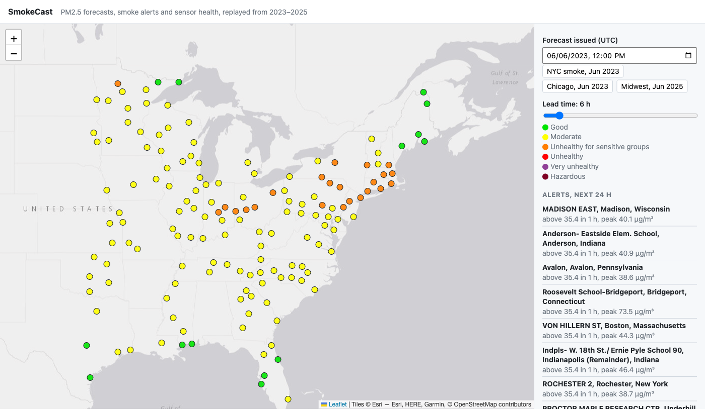
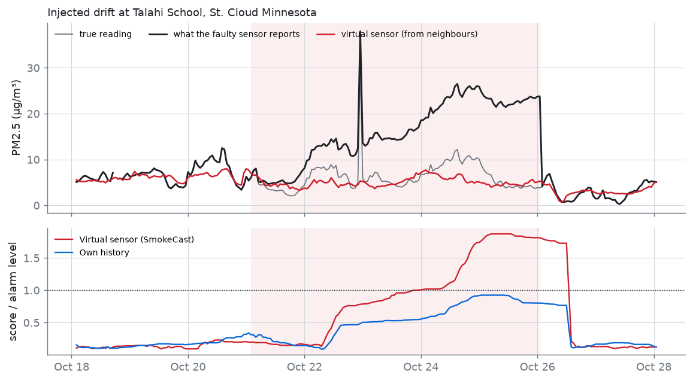
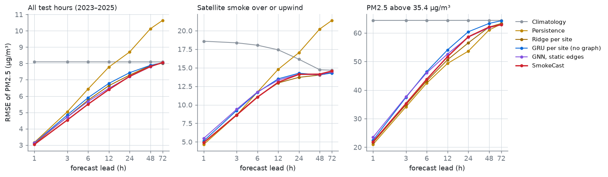
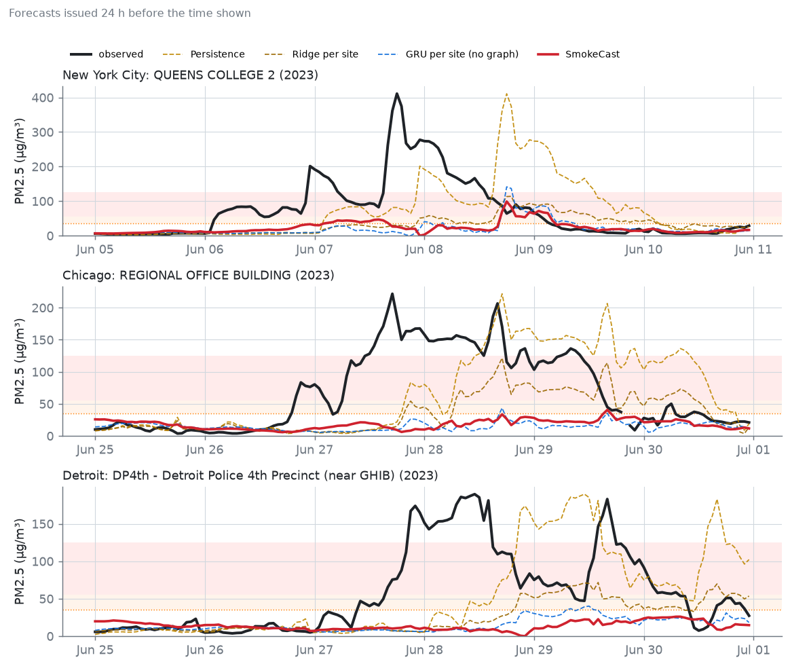
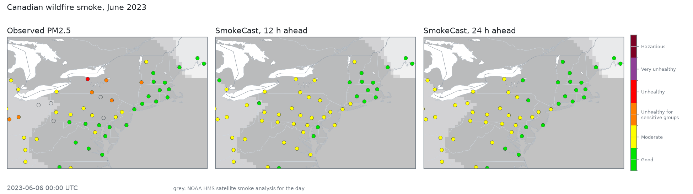
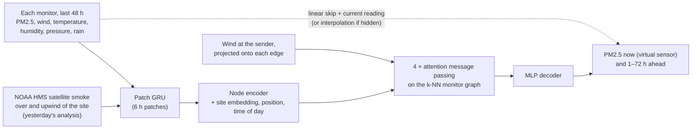

# SmokeCast

**A wind-aware graph neural network that forecasts PM2.5 1–72 hours ahead at
152 EPA monitors across the eastern US, checks every sensor against its
neighbours to catch faults, and ships as a Docker Compose service with an API
and a live map.**



*The dashboard replaying the morning of 6 June 2023, as Canadian wildfire
smoke moved into the Northeast: the 6 h forecast at every monitor, the sites
forecast to pass the AQI "unhealthy for sensitive groups" level, and a sensor
health panel where you can break a sensor and watch it get flagged.*

Every PM2.5 monitor is a node. Edges link nearby monitors, and each edge is
re-weighted every hour by the wind: a monitor hears most from the neighbours
whose air is blowing toward it. The model reads the last 48 hours of PM2.5,
airport weather and NOAA's satellite smoke analysis.

The same network works as a **virtual sensor**: hide one monitor and it
estimates what that monitor should be reading from its neighbours. A sensor
that drifts away from its virtual twin gets flagged.

It trains on 2017–2021, tunes on 2022, and is scored on January 2023 to
August 2025, a period that includes the worst wildfire smoke the eastern US
has on record.

## Results

### Catching faulty sensors

Real monitor records from 2023–2025 were corrupted with 295 five-day faults:
a +10 µg/m³ calibration offset, a drift growing to +20 µg/m³, a stuck
reading, and random noise. Three detectors watched the corrupted data, each
held to the **same false-alarm rate** (about 0.4% of sensor-hours, separately
in clear air and under smoke):

| Fault | Own history only | Interpolation from neighbours | SmokeCast virtual sensor |
|---|---:|---:|---:|
| Calibration offset | 19% | 62% | **68%** (median 17 h to flag) |
| Drift | 21% | 88% | **89%** |
| Stuck reading | 1% | **25%** | 24% |
| Noisy sensor | 97% | **100%** | **100%** |

Checking a sensor against its neighbours catches **3–4× more calibration
offsets and drifts** than checking it against its own history. That is the
main result. The GNN's virtual sensor beats plain inverse-distance
interpolation on offsets (68% vs 62%) and ties it elsewhere, so most of the
gain comes from comparing neighbours at all, not from the network.



*A drift of median difficulty, chosen by rank rather than picked by hand. The
virtual sensor's score crosses the alarm line about three days in; the
sensor's own history comes close but never does.*

### Forecasting PM2.5

Error is RMSE in µg/m³ over 23.6 million test forecasts (every hour, every
monitor, 7 lead times):

| Model | 1 h | 3 h | 6 h | 12 h | 24 h | 48 h | 72 h |
|---|---:|---:|---:|---:|---:|---:|---:|
| Climatology | 8.10 | 8.10 | 8.10 | 8.10 | 8.10 | 8.09 | 8.10 |
| Persistence | 3.16 | 5.04 | 6.43 | 7.78 | 8.70 | 10.13 | 10.64 |
| Ridge regression per site | 3.08 | 4.72 | 5.75 | 6.64 | 7.29 | 7.87 | **8.02** |
| GRU per site (no graph) | 3.13 | 4.84 | 5.90 | 6.78 | 7.43 | 7.88 | 8.04 |
| GNN, static edges | 3.14 | 4.71 | 5.67 | 6.47 | **7.19** | **7.79** | 8.06 |
| **SmokeCast** (wind-aware edges) | **3.03** | **4.53** | **5.50** | **6.40** | 7.21 | 7.81 | 8.05 |



- Over all hours SmokeCast is the most accurate model at 1–12 h, about 4%
  better than a tuned per-site ridge regression at 3–12 h and 18% better than
  persistence at 12 h. Beyond a day, every model converges on climatology.
- The graph does the work: a per-site GRU with identical inputs is worse than
  ridge regression. Wind-aware edges add a small, consistent improvement over
  static ones at short leads.
- **Early warnings** (hourly PM2.5 above 35.4 µg/m³, each method's warning
  level tuned on 2022): SmokeCast's critical success index is 0.38 at 6 h and
  0.26 at 12 h, against 0.35 and 0.22 for persistence and 0.34 and 0.22 for
  ridge regression. At 24 h all methods are near 0.14.

Full tables, including the smoke and high-PM subsets, are in
[results/metrics.md](results/metrics.md).

### Where it fails: record smoke



On 7 June 2023 PM2.5 at Queens College in New York reached **411 µg/m³**.
Six hours ahead SmokeCast forecast 63 µg/m³; persistence, which simply
repeats the current reading, said 94. **On hours above 35.4 µg/m³,
persistence beats every model at every lead up to 48 h**, SmokeCast
included. Under satellite smoke, SmokeCast is the best model only at 6 h, and
per-site ridge regression is best beyond that (see the smoke and high-PM
tables in [results/metrics.md](results/metrics.md)).

Two reasons, both fixable:

- **The test years are out of distribution.** 2023 and 2025 had six times as
  many hours above 55.4 µg/m³ as the average training year, and 2023 alone
  had more hours above 150 µg/m³ than all five training years combined.
- **The smoke comes from outside the network.** The plumes started in
  Quebec and Manitoba. A model that only sees US monitors, weather at the
  ground and yesterday's satellite outlines can see smoke arriving but not
  how thick it will be. Operational smoke forecasts (NOAA HRRR-Smoke) model
  fire emissions and transport directly. Their output is the obvious input to
  add next.



## How it works



**Wind-aware edges.** Smoke moves with the wind, so the graph should too. For
an edge from monitor *j* to monitor *i*, the model gets the component of *j*'s
recent wind along the edge, the wind speed, and `exp(-transit / 24 h)`, where
transit = distance / along-edge wind. That last number is near 1 when air from
*j* reaches *i* within hours and 0 when the wind blows the other way. The
attention weights decide what to do with it.

**Satellite smoke.** Analysts at NOAA's Hazard Mapping System outline smoke
plumes on GOES satellite imagery every day, graded light, medium or heavy.
SmokeCast rasterises each day's polygons and samples them over each monitor
and at 100, 200 and 300 km upwind along the current wind. It uses
*yesterday's* analysis, so every input exists at forecast time.

**Virtual sensor.** During training, 15% of monitors are hidden in every
sample: their PM2.5 history is zeroed and marked missing. The model starts
from inverse-distance interpolation of the visible neighbours and learns a
correction, at lead 0 (the current hour) and for the forecast. The same
mechanism keeps forecasts sensible when a monitor goes offline.

**Fault scoring.** Each detector turns its deviation series into two robust
24 h statistics: the size of the median deviation (offsets, drift, a stuck
sensor as the truth moves away) and the median hour-to-hour jump (noise).
Thresholds are set separately for clear air and for hours under satellite
smoke, when every comparison is noisier. A single threshold would be either
deaf in clear air or jumpy in smoke.

**Message passing** is written from scratch in PyTorch (segment softmax over
incoming edges, `index_add` aggregation, interaction-network edge updates). It
shares its core with [SurgeCast](https://github.com/kiransilwal10/surgecast),
the storm-surge model this project grew out of.

## Running the service

```bash
python scripts/export_serving.py      # model + 2023–2025 inputs -> serving/ (38 MB)
docker compose up                     # http://localhost:8000
```

| Endpoint | Returns |
|---|---|
| `GET /api/forecast?issued=2023-06-06T12:00` | PM2.5 now and 1–72 h ahead at every monitor |
| `GET /api/alerts?issued=…&within_h=24` | monitors forecast above 35.4 µg/m³, with lead and peak |
| `GET /api/sensors?issued=…&simulate_fault=36-081-0124` | per-sensor health score; optionally breaks one sensor (+15 µg/m³ for 48 h) to demo detection |
| `GET /api/health`, `GET /api/sites` | status and monitor metadata |

The service replays the test period, because a live feed (AirNow, OpenAQ)
needs an API key. Swapping one in only changes where the inputs come from.
The container runs CPU-only PyTorch. On an Apple M4 CPU a forecast for all
152 monitors takes about 15 ms, and a health check of every sensor (nine
masked passes over 24 hours) under a second.

## Evaluation

- **Splits by year:** train 2017–2021, validation 2022, test 1 January 2023 to
  26 August 2025. NOAA stopped publishing ISD-Lite airport weather at the end
  of August 2025, which sets the end date.
- **Causal inputs:** gaps of at most 2 h are forward-filled, the satellite
  smoke used for any hour is the previous day's analysis, and forecast windows
  never cross a split.
- **Baselines:** climatology (site × month × hour of day), persistence, and a
  ridge regression per site on the same 48 h of inputs, with its penalty picked
  on 2022.
- **Ablation:** per-site GRU (graph off), GNN with static edges, and the full
  model. All share architecture, data and training budget, and each is a
  single training run, so differences under about 1% are within noise.
- **Faults:** injected into the clean record with a fixed seed, five days
  each, never overlapping at one site. Thresholds are calibrated on the clean
  test record itself, in the same way for every detector.

## Data

| Source | What | Used for |
|---|---|---|
| [EPA AQS](https://aqs.epa.gov/aqsweb/airdata/download_files.html) | hourly PM2.5 (parameter 88101) at 152 monitors, 2017–2025 | inputs and targets |
| [NOAA ISD-Lite](https://www.ncei.noaa.gov/products/land-based-station/integrated-surface-database) | hourly wind, temperature, dew point, pressure, rain at the nearest airport (median 8.8 km away) | weather inputs, wind-aware edges |
| [NOAA HMS](https://www.ospo.noaa.gov/Products/land/hms.html) | daily smoke polygons from GOES imagery, 3,161 days | satellite smoke inputs |

Monitors are kept if they report at least 75% of hours over 2017–2025, and
thinned so no two are within 60 km. None of the sources needs an API key.

## Training on a free GPU

[`kaggle/`](kaggle) runs training, evaluation and fault detection on a Kaggle
T4 in about 35 minutes. Data and code go up as two private datasets, and the
results come back with `kaggle kernels output`. An epoch takes about 38 s on
the T4 and 95 s on an Apple M4 laptop.

## Repository layout

```
src/smokecast/
  sources.py    EPA AQS, NOAA ISD-Lite and HMS downloads and parsers
  geo.py        great-circle geometry, wind components
  dataset.py    QC, causal features, upwind smoke sampling, on-device batching
  graph.py      k-NN monitor graph, static and wind-aware edge features
  layers.py     segment softmax, attention message-passing layer
  model.py      SmokeCast: encoder, processor, decoder, virtual sensor
  train.py      training loop with event oversampling, site masking, checkpoint/resume
  evaluate.py   baselines, ablation tables, warning skill, virtual-sensor test
  faults.py     fault injection and the three detectors
  viz.py        maps, skill curves, case studies, animation
  serve/        FastAPI app and the dashboard
scripts/        download, build dataset, figures, serving bundle, run everything
kaggle/         GPU training on Kaggle
tests/          unit tests for geometry, smoke sampling, graph, layers, faults and the API
```

## Reproduce

```bash
uv venv --python 3.12 && source .venv/bin/activate
uv pip install -e ".[maps,serve,dev]"
bash scripts/run_experiments.sh      # download -> build -> train 3 models -> evaluate -> faults -> figures
pytest -q                            # unit tests (no data needed)
```

The download is about 1 GB of EPA, NOAA and HMS files and takes 30–40 minutes.

## Limitations

- **Peaks.** It under-forecasts heavy smoke badly (see above). Adding
  HRRR-Smoke forecasts or fire detections as inputs is the next step.
- **Mean-squared-error loss.** It pulls forecasts toward the middle. Tuning
  each model's warning level on 2022 offsets this for alerts but not for the
  forecast values; a quantile loss would give calibrated upper bounds.
- **The virtual sensor is only as good as interpolation in smoke.** Under
  heavy smoke, inverse-distance interpolation is more accurate (9.08 vs
  9.62 µg/m³). At the June 2023 peak, 5 of 152 sensors were flagged with no
  fault injected, most likely because plume edges make close neighbours
  disagree.
- **One training run per model.** Small differences between the graph
  variants are within run-to-run noise.

## License

MIT
